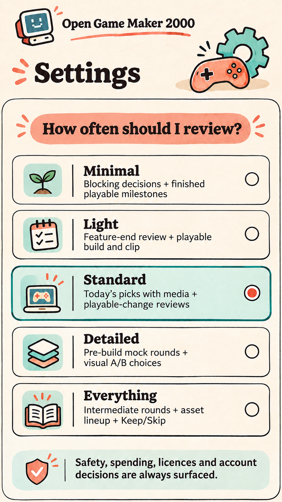
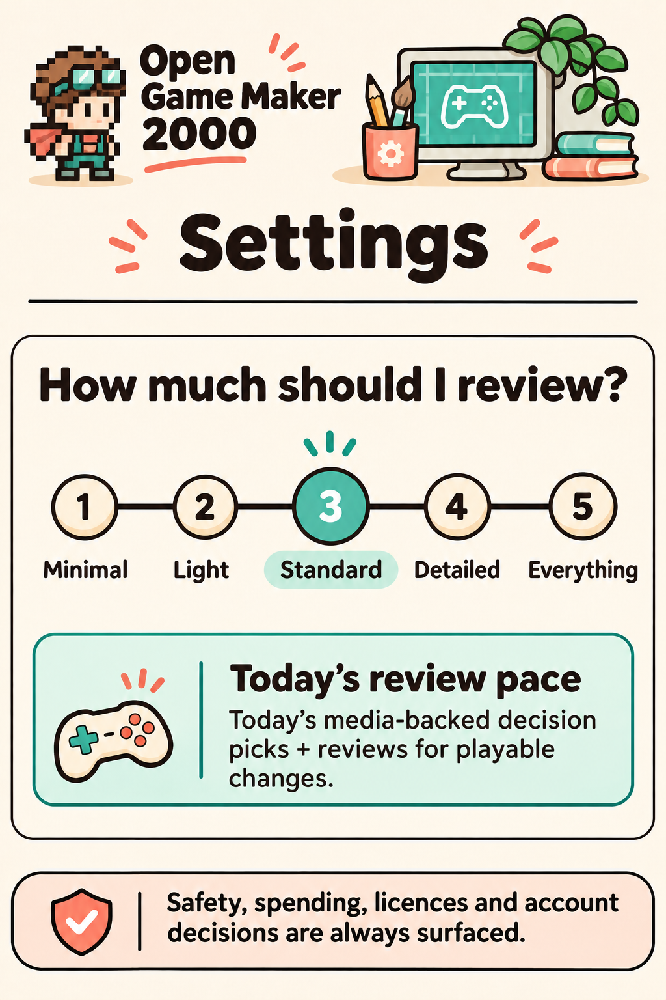
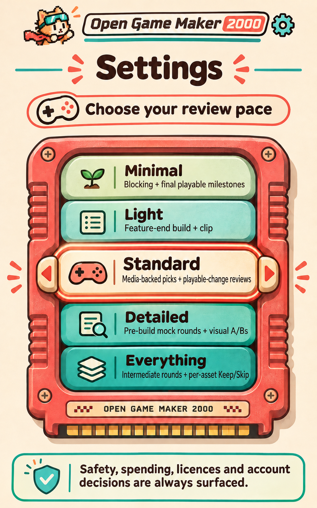
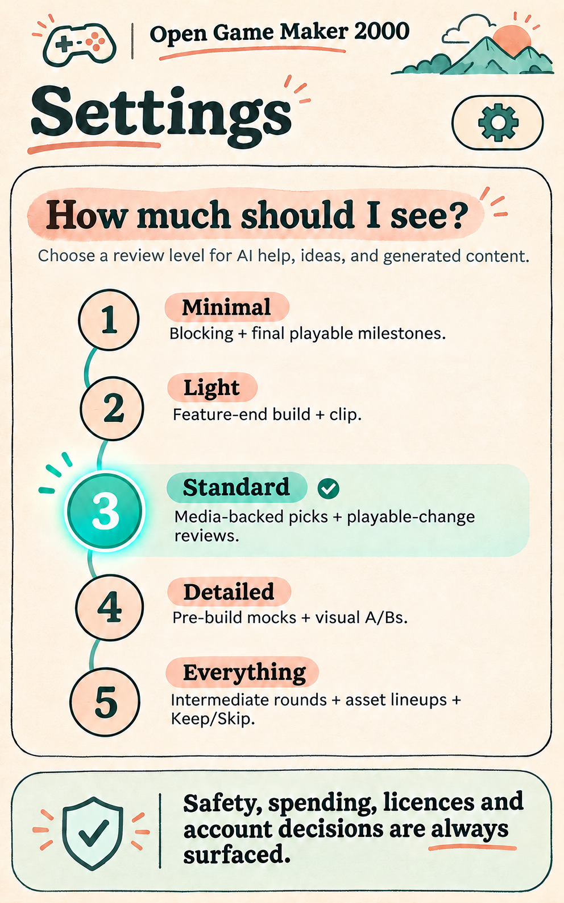

# Review intensity setting mockups

AI-generated phone-portrait mockups for the five-step creator setting in issue #1393. These are visual directions, not production UI.

| Option | Direction | Decision it represents |
| --- | --- | --- |
| A | Stacked rows | Show all five tiers and their summaries together; easiest to compare at a glance. |
| B | Horizontal stepper | Keep the five-step scale compact, with a focused summary for the selected tier. |
| C | Tactile selector | Present the tiers as a playful, game-inspired selector. |
| D | Numbered path | Make the progression from least to most review explicit with a vertical scale. |

**Recommendation: B — Horizontal stepper.** It makes the five levels legible as one scale while using less vertical space than five full-height cards. Keep Standard selected by default. All options include the invariant that safety, spending, licence and account decisions are always surfaced.

## Proposed tier meanings

These are the five behavior levels shown by the setting. The mock captions are shortened to fit their layouts.

| Tier | Review behavior |
| --- | --- |
| Minimal | Surface only blocking decisions and finished, playable milestones. Agents decide other choices and log them. |
| Light | Add a review at the end of each feature, with a playable build and clip. |
| Standard | Keep today's behavior: decision inventory picks with media and a review for each playable change. |
| Detailed | Add mock rounds before building and A/B options for visual choices. |
| Everything | Add intermediate rounds, asset lineups and per-asset Keep/Skip choices. |

## Options

### A — Stacked rows

### B — Horizontal stepper

### C — Tactile selector

### D — Numbered path

