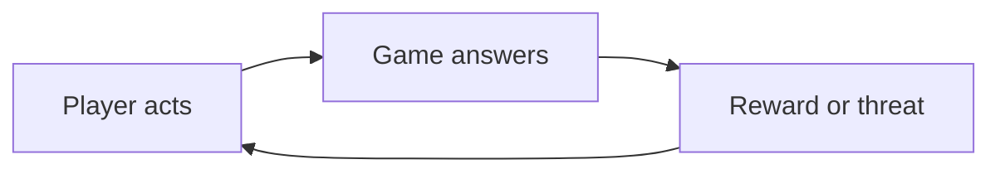
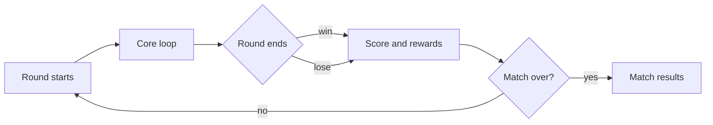
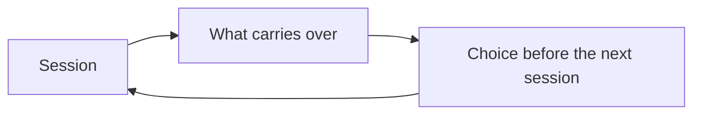
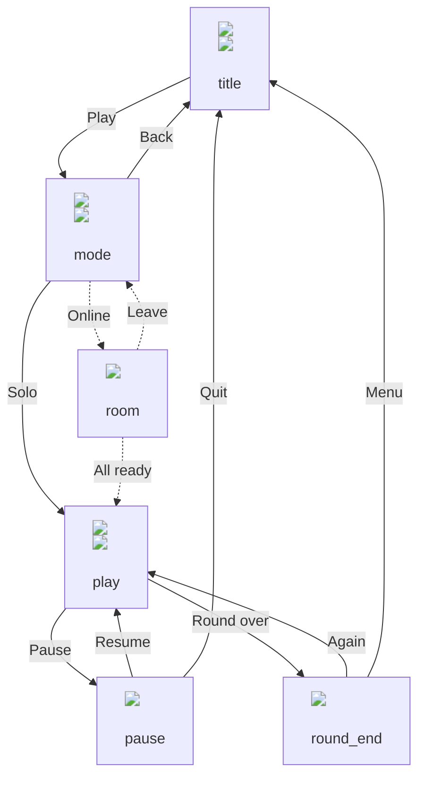

# <Game title> flow

Status: draft | in review (<command ids>) | approved (<decision ids>)

## Core loop

## Session loop

## Meta loop

## Navigation

## Screens

| Node | Target | Live | Tickets |
| --- | --- | --- | --- |
| title | screens/title.target.png (decision id) | screens/title.live.png (build) | #n |

## Open choices

| Id | Question | Options (media) | Recommended | Decision |
| --- | --- | --- | --- | --- |
| flow-1 | Mode or character first? | A: render/a.png, B: render/b.png | A, reason | pending |
